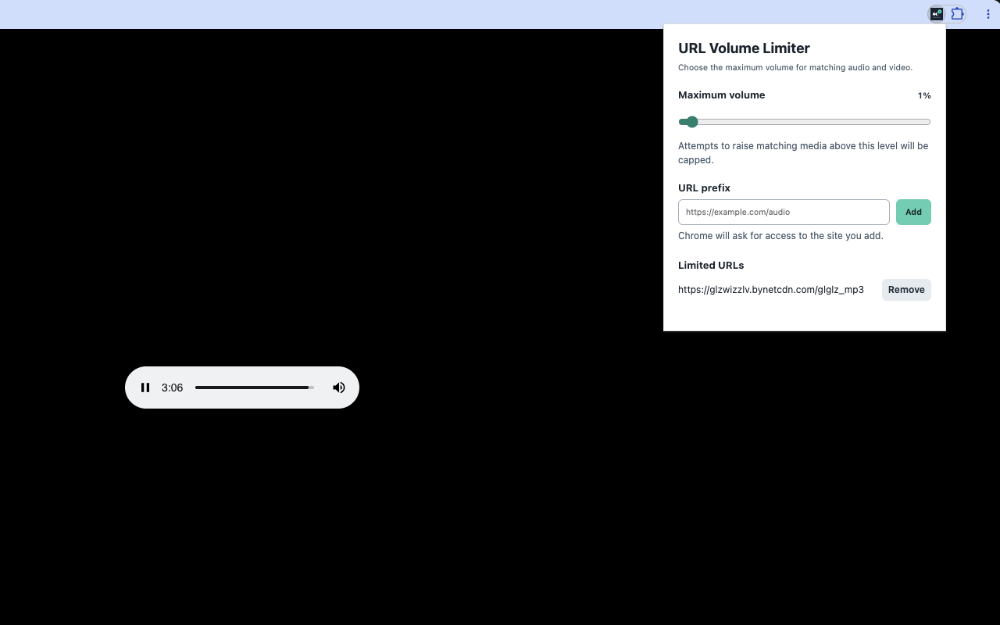

## Plugins/ Extensions/ etc. ##

**repo**: gematria-intellij-plugin - vsCode & intelliJ idea Gematria.
- see also live-plugins to go to the github's location of the current edited file

**repo**: whatshide - Chrome, dev only. Make WhatsApp web shows only white list of contacts 

**repo**: *this - url volume limiter. Already available on the stores:
- [Chrome](https://chromewebstore.google.com/detail/url-volume-limiter/ibblbifjdobdfhnbnamhbgpnockaoadc)
- [Edge](https://microsoftedge.microsoft.com/addons/detail/url-volume-limiter/inglkllnncaljljnkklfpmfpjebiocmc)
- [Firefox](https://addons.mozilla.org/en-GB/firefox/addon/url-volume-limiter/)
- Safari, dev only, WIP. Won't go to the public ($$)

